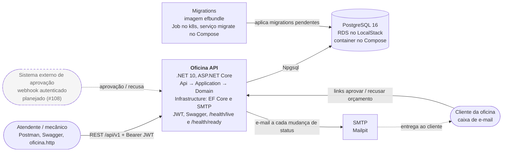
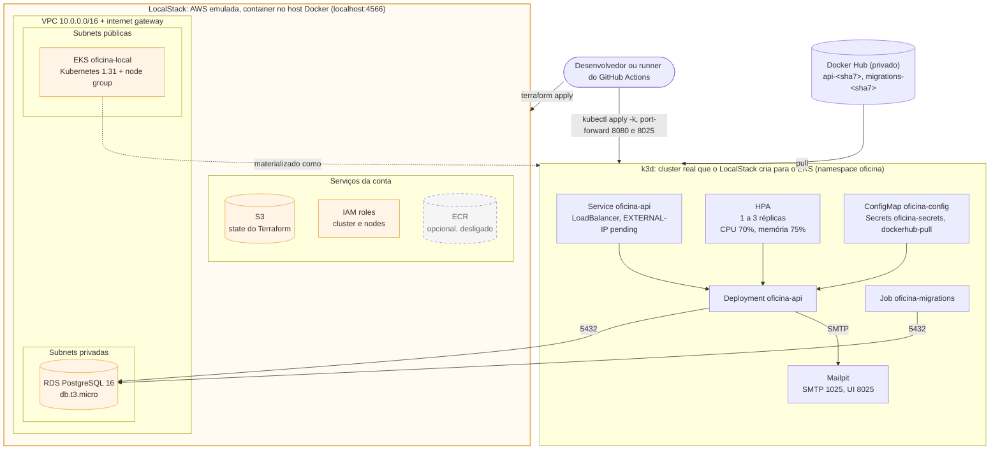
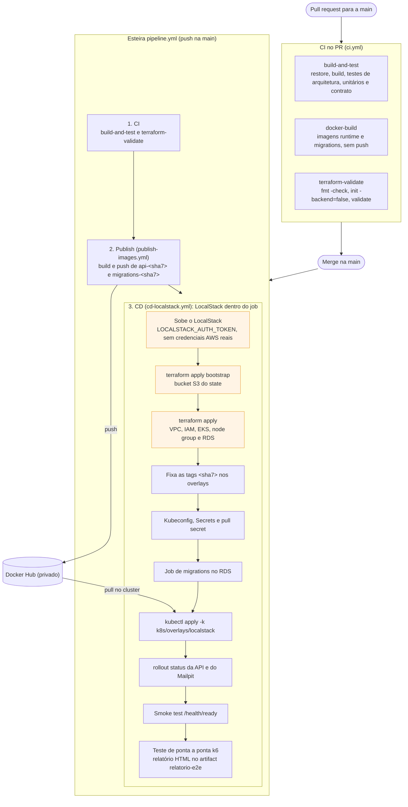

# Oficina API

[](https://github.com/thierryiago/SOAT-Fase-1-Lil-Golden-Hammer/actions/workflows/pipeline.yml)

API REST em .NET 10 para gestão operacional de uma oficina mecânica, cobrindo clientes, veículos, peças, estoque, mecânicos, serviços, ordens de serviço, orçamentos, histórico, métricas e notificações por e-mail.

## Sumário

- [Objetivo do projeto](#objetivo-do-projeto)
  - [Objetivos da Fase 2](#objetivos-da-fase-2)
- [Arquitetura](#arquitetura)
- [Desenho da arquitetura](#desenho-da-arquitetura)
  - [Componentes da aplicação](#componentes-da-aplicação)
  - [Infraestrutura provisionada](#infraestrutura-provisionada)
  - [Fluxo de deploy](#fluxo-de-deploy)
- [Stack tecnológica](#stack-tecnológica)
- [Estrutura do repositório](#estrutura-do-repositório)
- [Requisitos mínimos](#requisitos-mínimos)
- [Como rodar a aplicação](#como-rodar-a-aplicação) (execução local com Docker Compose)
  - [Configuração inicial](#passo-2-configure-a-aplicação)
  - [Docker Compose](#passo-3-inicialize-os-serviços-com-docker)
  - [Validação da aplicação](#passo-4-verifique-se-a-api-subiu)
  - [Teste da API](#passo-5-teste-a-api)
- [Health checks, imagem Docker e HTTPS](#health-checks-imagem-docker-e-https)
- [Executando direto com .NET](#executando-direto-com-net)
- [Provisionamento da infraestrutura com Terraform](#provisionamento-da-infraestrutura-com-terraform)
- [Deploy em Kubernetes](#deploy-em-kubernetes)
- [Autenticação e autorização](#autenticação-e-autorização)
- [Endpoints principais](#endpoints-principais)
- [Fluxo de ordens de serviço](#fluxo-de-ordens-de-serviço)
- [Banco de dados](#banco-de-dados)
- [Migrations](#migrations)
- [Testes](#testes)
- [CI/CD](#cicd)
- [LocalStack: decisão e limitações](#localstack-decisão-e-limitações)
- [Mailpit para desenvolvimento](#mailpit-para-desenvolvimento)
- [Arquivo de chamadas HTTP](#arquivo-de-chamadas-http)
- [Entregáveis](#entregáveis)
- [Resumo](#resumo)

## 🧭 Objetivo do projeto

O sistema foi concebido para centralizar e automatizar os processos da oficina, com foco em:

- cadastro e consulta de clientes e veículos;
- controle de peças e estoque;
- cadastro de mecânicos e serviços;
- abertura, atualização e acompanhamento de ordens de serviço;
- rastreio de histórico de status;
- geração e consulta de orçamentos;
- métricas de execução por serviço;
- envio de notificações por e-mail.

A solução segue princípios de Clean Architecture, separando domínio, aplicação, infraestrutura e API.

### Objetivos da Fase 2

Com o sistema da Fase 1 em uso, a oficina passou a ter mais demanda e planeja novas unidades. A Fase 2 evolui a aplicação para garantir qualidade, resiliência e escalabilidade, com práticas modernas de infraestrutura e automação:

| Objetivo da fase | Como foi atendido |
|---|---|
| Reduzir riscos operacionais com infraestrutura escalável | API em Kubernetes ([`k8s/`](k8s/)), com probes de liveness e readiness e banco gerenciado (RDS) |
| Automatizar o provisionamento e o deploy | Terraform ([`infra/`](infra/)) e esteira de [CI/CD](#cicd) que provisiona, migra o banco e faz o deploy a cada merge na `main` |
| Melhorar a qualidade e a organização do código | Refatoração para [Clean Architecture](#arquitetura) com use cases e ports, testes de domínio, aplicação, contrato e arquitetura |
| Suportar picos de ordens de serviço | HPA por CPU e memória (1 a 3 réplicas), validado com teste de carga k6 ([`k8s/loadtest/`](k8s/loadtest/)) |

APIs criadas ou alteradas na fase:

- **Abertura de OS completa:** `POST /api/v1/service-orders`, com cliente, veículo, serviços e peças, devolvendo o identificador da OS.
- **Consulta de status da OS:** `GET /api/v1/service-orders/{id}/track?document=...` (pública, pelo documento do cliente) e `GET /api/v1/service-orders/{id}`.
- **Listagem priorizada:** `GET /api/v1/service-orders/status`, ordenada por `InExecution` > `AwaitingApproval` > `InDiagnosis` > `Received` e da OS mais antiga para a mais nova, sem as finalizadas e entregues (exclusão lógica, só na consulta).
- **Atualização de status por e-mail:** o cliente recebe um e-mail a cada mudança de status. O e-mail de orçamento traz links para aprovar ou recusar (`GET /api/v1/notifications/approveBudget` e `rejectBudget`).
- **Aprovação de orçamento por notificação externa:** o webhook autenticado para sistemas externos ainda está em aberto ([#108](https://github.com/thierryiago/SOAT-Fase-1-Lil-Golden-Hammer/issues/108)).

A infraestrutura de nuvem (VPC, EKS, RDS, IAM e S3) é **emulada pelo [LocalStack](https://www.localstack.cloud/)**: nenhum recurso da AWS real é usado. A justificativa está em [LocalStack: decisão e limitações](#localstack-decisão-e-limitações).

---

## 🏗️ Arquitetura

A estrutura do projeto está organizada em camadas:

- `src/Oficina.Domain` — entidades, regras de negócio e enums;
- `src/Oficina.Application` — serviços de aplicação, DTOs e contratos de repositório;
- `src/Oficina.Infrastructure` — EF Core, repositórios, SMTP, DI e persistência;
- `src/Oficina.Api` — controllers, autenticação, Swagger e bootstrap da API;
- `tests/Oficina.Tests` — testes unitários e de aplicação;
- `tests/Oficina.Api.ContractTests` — testes de contrato e integração HTTP.

Dependências:

- `Api -> Application -> Domain`
- `Infrastructure -> Application + Domain`

A feature de orçamentos usa cinco Use Cases dedicados na Application: listagem,
consulta por ID, abertura a partir da OS e decisão por OS ou por ID do orçamento.
Controllers e Service Orders injetam diretamente essas operações, registradas como
`Scoped`. A abertura mantém snapshots e versões anteriores; rotas e contratos HTTP
permanecem iguais.

---

## 🗺️ Desenho da arquitetura

> **A nuvem é emulada pelo LocalStack.** Os blocos em laranja (VPC, subnets, EKS, RDS, IAM e S3) são criados pelo Terraform no LocalStack, sem conta na AWS real. O EKS é materializado pelo LocalStack como um cluster Kubernetes real (k3d), onde os manifestos de `k8s/` são aplicados. Itens tracejados são opcionais ou ainda planejados.

As fontes ficam em [`docs/diagramas/`](docs/diagramas/) (`.mmd`), junto com as versões em SVG e PNG para o PDF de entrega. Para regerar as imagens, rode `docs/diagramas/exportar.ps1`. Ao alterar um diagrama, atualize também o bloco correspondente abaixo.

### Componentes da aplicação

A API conversa com o PostgreSQL e com o servidor SMTP. As migrations rodam numa imagem própria, antes da API ([ADR 0002](docs/adr/0002-migrations-via-bundle.md)). O cliente acompanha a OS por e-mail e aprova ou recusa o orçamento pelos links da mensagem.



Imagens: [SVG](docs/diagramas/componentes.svg) · [PNG](docs/diagramas/componentes.png)

### Infraestrutura provisionada

O Terraform cria a rede, as IAM roles, o cluster EKS com node group e o RDS no LocalStack. O Kustomize aplica no cluster o Deployment da API com HPA, o Service, o ConfigMap, o Mailpit e o Job de migrations. As imagens vêm de um repositório privado do Docker Hub.



Imagens: [SVG](docs/diagramas/infraestrutura.svg) · [PNG](docs/diagramas/infraestrutura.png)

### Fluxo de deploy

O pull request passa pelo CI. Depois do merge, a esteira publica as imagens do commit e o CD sobe um LocalStack dentro do próprio job, provisiona a infraestrutura, migra o banco, aplica os manifestos e valida o deploy. Detalhes em [CI/CD](#cicd).



Imagens: [SVG](docs/diagramas/fluxo-deploy.svg) · [PNG](docs/diagramas/fluxo-deploy.png)

---

## 🧰 Stack tecnológica

- .NET 10
- ASP.NET Core
- C#
- Entity Framework Core
- PostgreSQL
- Npgsql
- JWT Bearer
- Swagger / OpenAPI
- Docker / Docker Compose
- SMTP para e-mail (Mailpit em desenvolvimento e no cluster)
- xUnit + WebApplicationFactory
- Kubernetes com Kustomize (Deployment, Service, ConfigMap, Secret, HPA e Jobs)
- Terraform (VPC, IAM, EKS, RDS e S3 do state)
- LocalStack (AWS emulada; EKS materializado com k3d)
- GitHub Actions (CI, publicação das imagens e CD)
- Docker Hub (repositório privado das imagens)
- k6 (teste de carga e teste de ponta a ponta)

---

## 📁 Estrutura do repositório

```text
.
├── .github/workflows/      # pipeline.yml (esteira), ci.yml, publish-images.yml, cd-localstack.yml
├── src/
│   ├── Oficina.Api/
│   ├── Oficina.Application/
│   ├── Oficina.Domain/
│   └── Oficina.Infrastructure/
├── tests/
│   ├── Oficina.Tests/
│   └── Oficina.Api.ContractTests/
├── infra/                  # Terraform: bootstrap do state, rede, IAM, EKS, RDS e ECR opcional
├── k8s/                    # Kustomize: base, overlay localstack, scripts, teste de carga e e2e
├── docs/
│   ├── adr/                # decisões de arquitetura
│   ├── diagramas/          # diagramas Mermaid e exportações SVG/PNG
│   ├── Oficina-API.postman_collection.json
│   └── SYSTEM_CONTEXT.md
├── docker-compose.yml
├── Dockerfile
├── Oficina.sln
├── oficina.http
├── README.md
└── seed-data.sql
```

---

## ⚙️ Requisitos mínimos

Para a execução local (Docker Compose ou `dotnet run`):

- .NET 10 SDK
- Docker e Docker Compose
- PostgreSQL (se for rodar sem Docker)
- VS Code, Rider ou Visual Studio
- Git

Para provisionar a infraestrutura e fazer o deploy em Kubernetes no LocalStack:

- Terraform ≥ 1.10 e `kubectl`;
- PowerShell (os scripts de `infra/scripts` e `k8s/scripts` são `.ps1`);
- conta no LocalStack com `LOCALSTACK_AUTH_TOKEN`, porque o EKS do LocalStack exige um plano com token;
- container do LocalStack com o socket do Docker montado e as portas `4566` e `4510-4559` publicadas (comando em [Provisionamento da infraestrutura com Terraform](#provisionamento-da-infraestrutura-com-terraform));
- um Access Token de leitura do Docker Hub com acesso ao repositório das imagens (`DOCKERHUB_USERNAME` e `DOCKERHUB_TOKEN`).

---

## 🚀 Como rodar a aplicação

### Passo 1: clone o projeto

```bash
git clone <url-do-repositorio>
cd 17SOAT-Fase1
```

### Passo 2: configure a aplicação

O `appsettings.json` contém apenas configurações sem segredo. A API lê as variáveis de ambiente do .NET; para desenvolvimento local, também carrega o `.env` da raiz sem sobrescrever variáveis já definidas no sistema.

Exemplo de `appsettings.json`:

```json
{
  "AllowedHosts": "*",
  "Jwt": {
    "Issuer": "Oficina.Api",
    "Audience": "Oficina.Administration",
    "ExpirationMinutes": 120
  },
  "Smtp": {
    "Host": "smtp.example.com",
    "Port": 587,
    "From": "noreply@example.com",
    "EnableSsl": true
  }
}
```

Crie o `.env` a partir do exemplo e ajuste os valores:

```bash
cp .env.example .env
```

O mesmo `.env` é usado pelo Docker Compose (interpolação do `docker-compose.yml`) e pelo `dotnet run` (a API carrega o `.env` da raiz). Ajuste `App__PublicBaseUrl` para a origem pública usada em cada execução: `http://localhost:8080` no Compose ou `https://localhost:5001` no perfil local do `dotnet run`. A URL deve conter apenas esquema HTTP(S), host e porta opcional; a API valida esse valor ao iniciar.

| Variável | Destino K8S-3 | Uso |
|---|---|---|
| `App__PublicBaseUrl` | ConfigMap | Origem pública dos links de decisão nos e-mails; obrigatória no startup |
| `ConnectionStrings__Database` | Secret | Connection string da API e do Job de migrations; no Compose é montada a partir de `POSTGRES_DB`, `POSTGRES_USER` e `POSTGRES_PASSWORD` |
| `Jwt__SigningKey` | Secret | Chave de assinatura do JWT, com pelo menos 32 bytes |
| `Smtp__Host`, `Smtp__Port`, `Smtp__From`, `Smtp__EnableSsl` | ConfigMap | Endereço, porta, remetente e TLS do SMTP; Mailpit no Compose |
| `Smtp__Username`, `Smtp__Password` | Secret | Credenciais opcionais do SMTP; omitir quando o servidor não exige autenticação |
| `Webhooks__BudgetDecisionToken` | Secret | Reservado para K8S-3; ainda não é consumido pelos endpoints de decisão |

No Compose, `POSTGRES_PASSWORD` também deve vir de um segredo local. Para `dotnet run`, defina `ConnectionStrings__Database` no ambiente ou no `.env`; o valor de `appsettings.json` não fornece fallback.

> Importante: nunca versionar segredos reais em Git. O `.env` é ignorado pelo `.gitignore`.

### Passo 3: inicialize os serviços com Docker

Na raiz do projeto:

```bash
docker compose up --build -d
```

Os serviços sobem nesta ordem:

1. `db` (PostgreSQL) e `mailpit`;
2. `migrate`, que aplica as migrations e encerra (ver [Migrations](#migrations));
3. `api`, que só inicia se o `migrate` terminar com sucesso;
4. `seed`, que carrega os dados de exemplo depois que a API fica saudável.

Sem o `.env`, o `docker compose up` falha informando a variável obrigatória que falta.

> Se você já tinha o volume do banco criado com a senha antiga (`oficina_dev_password`), o PostgreSQL mantém essa senha. Use-a em `POSTGRES_PASSWORD` ou recrie o volume com `docker compose down -v` (apaga os dados locais).

### Passo 4: verifique se a API subiu

Depois do startup, valide:

- API: `http://localhost:8080`
- Swagger: `http://localhost:8080/swagger`
- Health checks: `http://localhost:8080/health/live` (liveness) e `http://localhost:8080/health/ready` (readiness, verifica o Postgres)
- Mailpit: `http://localhost:8025`

### Passo 5: teste a API

Acesse o Swagger em:

```text
http://localhost:8080/swagger
```

No Swagger, use o endpoint de geração de token:

```http
POST /api/v1/auth/token
```

Copie o token e o envie em todas as requisições protegidas:

```http
Authorization: Bearer <accessToken>
```

---

## 🩺 Health checks, imagem Docker e HTTPS

### Endpoints de saúde

| Rota | Verifica | Uso | Resposta |
|---|---|---|---|
| `/health/live` | nada (só que o processo responde) | `livenessProbe` | `200` |
| `/health/ready` | conexão com o Postgres | `readinessProbe` e healthcheck do compose | `200` ou `503` com o banco indisponível |
| `/health` | nada (igual ao `/health/live`) | compatibilidade | `200` |

Todos são anônimos e sem cache. Exemplo para o Kubernetes: `livenessProbe.httpGet.path: /health/live` e `readinessProbe.httpGet.path: /health/ready`, porta `8080`.

### Imagem Docker

- **Tags fixadas:** o `Dockerfile` usa `SDK_VERSION` e `RUNTIME_VERSION` (tags de patch). Para atualizar, ajuste os dois `ARG` e valide o build.
- **Labels OCI:** `org.opencontainers.image.version` e `.revision` vêm dos `ARG VERSION` e `VCS_REF`:
  ```bash
  docker build --build-arg VERSION=1.0.0 --build-arg VCS_REF=$(git rev-parse HEAD) -t oficina-api .
  ```
  Sem os argumentos, ficam `dev` e `unknown`.
- **Sem `curl`:** a imagem final não instala `curl`. O healthcheck do compose faz a requisição com `bash` (`/dev/tcp`). No Kubernetes o probe é `httpGet` do kubelet e não precisa de nada na imagem.
- **Redirecionamento HTTPS:** controlado por `HttpsRedirection__Enabled` (padrão `true` no `dotnet run`). A imagem define `false`, porque o TLS termina no proxy/ingress.

## 🧪 Executando direto com .NET

Se preferir rodar sem Docker:

```bash
dotnet restore
dotnet build
dotnet run --project src/Oficina.Api/Oficina.Api.csproj
```

Antes disso, confirme que o PostgreSQL está acessível e que os dados de conexão estão corretos.

A API **não** aplica migrations ao iniciar. Antes de rodá-la, atualize o banco de uma das formas:

```bash
# banco e migrations pelo Docker Compose
docker compose up -d db migrate

# ou, com um PostgreSQL próprio
dotnet ef database update \
  --project src/Oficina.Infrastructure \
  --startup-project src/Oficina.Api
```

---

## 🏗️ Provisionamento da infraestrutura com Terraform

Os scripts ficam em [`infra/`](infra/) e criam toda a infraestrutura no **LocalStack**, sem AWS real. O passo a passo completo, com troubleshooting, está em [`infra/README.md`](infra/README.md).

| Arquivo | Recursos criados |
|---|---|
| `infra/bootstrap/` | Bucket S3 do state remoto (configuração separada, com state local) |
| `network.tf` | VPC `10.0.0.0/16`, subnets públicas e privadas, internet gateway, rotas e security group do cluster |
| `iam.tf` | IAM roles do cluster EKS e do node group |
| `eks.tf` | Cluster EKS (Kubernetes 1.31) e node group |
| `rds.tf` | PostgreSQL 16 (`aws_db_instance`), subnet group, security group e senha gerada (`random_password`) |
| `ecr.tf` | Repositórios ECR opcionais (`create_ecr`, desligado por padrão) |
| `images.tf` | Referência das imagens no Docker Hub (output `app_images`) |

**1. Suba o LocalStack** com o socket do Docker e a faixa de portas do RDS e do EKS:

```powershell
docker run -d --name localstack -p 4566:4566 -p 4510-4559:4510-4559 -e LOCALSTACK_AUTH_TOKEN=$env:LOCALSTACK_AUTH_TOKEN -v /var/run/docker.sock:/var/run/docker.sock -v localstack-data:/var/lib/localstack localstack/localstack
curl http://localhost:4566/_localstack/health
```

**2. Crie o bucket do state** (sempre antes da infra; sem ele o `init` falha com `NoSuchBucket`):

```bash
terraform -chdir=infra/bootstrap init
terraform -chdir=infra/bootstrap apply
```

**3. Provisione a rede, o cluster e o banco:**

```bash
cp infra/terraform.tfvars.example infra/terraform.tfvars   # opcional
terraform -chdir=infra init
terraform -chdir=infra plan
terraform -chdir=infra apply
```

**4. Gere o kubeconfig** (PowerShell, com o ponto na frente). O arquivo é gravado em `%USERPROFILE%\kubeconfig-oficina`, sem alterar o `~/.kube/config`:

```powershell
. .\infra\scripts\kubeconfig.ps1
kubectl get nodes
```

Para destruir: `terraform -chdir=infra destroy` e, depois, `terraform -chdir=infra/bootstrap destroy`. O LocalStack guarda os dados em memória, então recriar o container apaga o state e exige repetir os passos 2 e 3.

---

## ☸️ Deploy em Kubernetes

Os manifestos ficam em [`k8s/`](k8s/), em Kustomize puro, aplicados com `kubectl`. O único ambiente é o overlay [`k8s/overlays/localstack`](k8s/overlays/localstack/), que mira o cluster EKS criado pelo Terraform. Ele roda na sua máquina, com o LocalStack local, ou no runner do CD. Detalhes em [`k8s/README.md`](k8s/README.md).

| Recurso | Arquivo | Função |
|---|---|---|
| Namespace `oficina` | `k8s/base/namespace.yaml` | Isola os recursos da aplicação |
| Deployment `oficina-api` | `k8s/base/api/deployment.yaml` | API com probes de startup, liveness e readiness, e `requests`/`limits` |
| Service `oficina-api` | `k8s/base/api/service.yaml` + patch do overlay | `LoadBalancer` por paridade com o EKS |
| HPA `oficina-api` | `k8s/base/api/hpa.yaml` | 1 a 3 réplicas, alvo de 70% de CPU e 75% de memória |
| ConfigMap `oficina-config` | `configMapGenerator` da base e do overlay | Configuração não sensível (SMTP, JWT issuer/audience, URL pública) |
| Secrets `oficina-secrets` e `dockerhub-pull` | `k8s/scripts/create-secrets.ps1` e `create-pull-secret.ps1` | Connection string, chave JWT, token do webhook e credencial de pull; nada é versionado |
| Job `oficina-migrations` | `k8s/base/migrations/` + `k8s/scripts/run-migrations.ps1` | Aplica as migrations no RDS antes da API |
| Mailpit | `k8s/base/mailpit/` | SMTP do cluster (1025) e UI (8025) |

Com o Terraform aplicado e o kubeconfig carregado:

```powershell
$env:DOCKERHUB_USERNAME = "<usuário>"
$env:DOCKERHUB_TOKEN    = "<access token de leitura>"
.\k8s\scripts\create-secrets.ps1      # connection string vem do terraform output; chaves geradas se ausentes
.\k8s\scripts\create-pull-secret.ps1  # Secret de pull do Docker Hub privado
.\k8s\scripts\run-migrations.ps1      # Job de migrations; para em caso de falha
kubectl apply -k k8s/overlays/localstack
kubectl -n oficina rollout status deployment/oficina-api
```

O `EXTERNAL-IP` do Service fica `<pending>`, porque o k3d do LocalStack não tem balanceador. O acesso é por `port-forward`:

```powershell
kubectl -n oficina port-forward svc/oficina-api 8080:80   # API e Swagger: http://localhost:8080/swagger
kubectl -n oficina port-forward svc/mailpit 8025:8025     # Mailpit: http://localhost:8025
```

Para ver o autoscaling, acompanhe `kubectl -n oficina get hpa oficina-api -w` e, em outro terminal, rode o teste de carga `.\k8s\loadtest\run-loadtest.ps1`. O k6 roda como Job dentro do cluster e distribui a carga entre as réplicas ([detalhes](k8s/README.md#autoscaling-e-teste-de-carga)). O teste de ponta a ponta do fluxo de negócio é o `.\k8s\e2e\run-e2e.ps1`.

---

## 🔐 Autenticação e autorização

A API usa autenticação JWT Bearer com token técnico único.

### Endpoints públicos

- `POST /api/v1/auth/token`
- `GET /health` (compatibilidade; equivale a `/health/live`)
- `GET /health/live`
- `GET /health/ready`

### Endpoints protegidos

A maior parte da API exige JWT, incluindo:

- clientes;
- veículos;
- peças;
- estoque;
- mecânicos;
- serviços;
- ordens de serviço;
- métricas;
- histórico.

> Observação: `BudgetsController` exige `[Authorize]` desde a ARCH-25. `NotificationsController` continua sem `[Authorize]` por decisão: é usado no fluxo do cliente, que não tem credencial administrativa.

---

## 🧾 Endpoints principais

### Auth

- `POST /api/v1/auth/token`

### Clientes

- `GET /api/v1/customers`
- `GET /api/v1/customers/{id}`
- `POST /api/v1/customers`
- `PUT /api/v1/customers/{id}`
- `DELETE /api/v1/customers/{id}`

### Veículos

- `GET /api/v1/vehicles`
- `GET /api/v1/vehicles/{id}`
- `POST /api/v1/vehicles`
- `POST /api/v1/vehicles/identify-customer-and-register`
- `PUT /api/v1/vehicles/{id}`
- `DELETE /api/v1/vehicles/{id}`

### Peças

- `GET /api/v1/parts`
- `GET /api/v1/parts/{id}`
- `POST /api/v1/parts`
- `PUT /api/v1/parts/{id}`
- `DELETE /api/v1/parts/{id}`

### Estoque

- `GET /api/v1/stocks`
- `GET /api/v1/stocks/{id}`
- `PUT /api/v1/stocks/stocks-part/{partId}/entries`
- `PUT /api/v1/stocks/stocks-part/{partId}/consumptions`
- `PUT /api/v1/stocks/stocks-part/{partId}/adjustments`

### Mecânicos

- `GET /api/v1/mechanics`
- `GET /api/v1/mechanics/{id}`
- `POST /api/v1/mechanics`
- `PUT /api/v1/mechanics/{id}`
- `DELETE /api/v1/mechanics/{id}`

### Serviços da oficina

- `GET /api/v1/workshop-services`
- `GET /api/v1/workshop-services/{id}`
- `POST /api/v1/workshop-services`
- `PUT /api/v1/workshop-services/{id}`
- `DELETE /api/v1/workshop-services/{id}`

### Ordens de serviço

As respostas dos endpoints de ordens de serviço apresentam `status` pelo nome do enum (por exemplo, `"AwaitingApproval"`), ou `null` quando não houver status.

- `GET /api/v1/service-orders`
- `GET /api/v1/service-orders/status` — lista autenticada por prioridade: `InExecution` > `AwaitingApproval` > `InDiagnosis` > `Received`. Dentro de cada status, retorna as OS mais antigas por `CreatedAt`, com desempate por `Id`. Exclui `Created`, `Rejected`, `Finalized`, `Delivered` e status nulo apenas desta consulta, preservando registros e históricos. Retorna `200` com uma lista (vazia quando não houver OS elegíveis) ou `401` sem autenticação. A listagem geral continua disponível sem esse filtro.
- `GET /api/v1/service-orders/{id}`
- `POST /api/v1/service-orders`
- `PUT /api/v1/service-orders`
- `POST /api/v1/service-orders/{id}/approve`
- `POST /api/v1/service-orders/{id}/cancel`
- `POST /api/v1/service-orders/{id}/finalize`
- `POST /api/v1/service-orders/{id}/deliver`

### Histórico

- `GET /api/v1/service-order-history`
- `GET /api/v1/service-order-history/service-order/{serviceOrderId}`

### Orçamentos

- `GET /api/v1/budgets`
- `GET /api/v1/budgets/{id}`

### Métricas

- `GET /api/v1/metrics/workshop-service/execution-time`

### Notificações

- `POST /api/v1/notifications/email`

---

## 🔄 Fluxo de ordens de serviço

O ciclo de vida da OS é governado pelo domínio e por regras de negócio da aplicação. Uma ordem recém-aberta possui o status `Created` até o checklist ser informado.

Estados principais:

- `Created`
- `Received`
- `InDiagnosis`
- `AwaitingApproval`
- `InExecution`
- `Finalized`
- `Delivered`
- `Rejected`

Fluxo geral:

```text
Created -> Received -> InDiagnosis -> AwaitingApproval -> InExecution -> Finalized -> Delivered
InDiagnosis -> AwaitingApproval -> Rejected
InExecution -- alteração de peças/serviços --> AwaitingApproval
```

### Como o status evolui

- `Created`: ordem aberta; ainda sem checklist validado;
- `Received`: checklist preenchido e OS recebida;
- `InDiagnosis`: mecânico atribuído e diagnóstico em andamento;
- `AwaitingApproval`: serviços adicionados e a aprovação do cliente é aguardada;
- `InExecution`: cliente aprovou e a execução começou;
- `Finalized`: execução concluída;
- `Delivered`: entrega finalizada;
- `Rejected`: aprovação negada, encerrando o processo.

Se peças ou serviços forem alterados durante `InExecution`, a OS retorna para
`AwaitingApproval`. O sistema ajusta o estoque pelos deltas, preserva o orçamento
aprovado, cria uma nova versão pendente e envia outro e-mail ao cliente. Reenviar a
mesma composição não solicita reaprovação, e ao menos um serviço de oficina deve
permanecer na OS.

Cada entrada em `AwaitingApproval` cria um novo orçamento. Os endpoints `approve` e
`cancel` registram a decisão no orçamento mais recente, enquanto as versões
anteriores permanecem inalteradas. Sempre que houver mudança de status, o sistema
registra um histórico em `ServiceOrderHistory` para auditoria.

---

## 🗃️ Banco de dados

O projeto usa PostgreSQL com EF Core e Fluent API para mapear as entidades.

### Diagrama Mermaid do banco


---

## 🛠️ Migrations

Para criar uma migration:

```bash
dotnet ef migrations add NomeDaMigracao \
  --project src/Oficina.Infrastructure \
  --startup-project src/Oficina.Api
```

Para aplicar:

```bash
dotnet ef database update \
  --project src/Oficina.Infrastructure \
  --startup-project src/Oficina.Api
```

> Importante: não edite `AppDbContextModelSnapshot.cs` manualmente; sempre gere a migration correta.

### Imagem de migração (bundle)

A API não migra o banco ao iniciar, para que várias réplicas não tentem migrar ao mesmo tempo. As migrations são aplicadas por uma imagem própria, gerada pelo target `migrations` do `Dockerfile` com `dotnet ef migrations bundle`.

| Item | Valor |
|---|---|
| Build | `docker build --target migrations -t oficina-migrations:dev .` |
| Variável obrigatória | `ConnectionStrings__Database` |
| Comportamento | Aplica só as migrations pendentes e encerra; pode ser executada de novo sem efeito |
| Exit code | `0` em sucesso; diferente de `0` em falha ou sem a variável |
| Usuário | Não-root |

O `dotnet ef migrations bundle` não acessa o banco: ele só gera o executável `efbundle` durante o build. As migrations são aplicadas quando o container roda:

```bash
docker run --rm \
  -e ConnectionStrings__Database="Host=<host>;Port=5432;Database=oficina;Username=<usuario>;Password=<senha>" \
  oficina-migrations:dev
```

No Docker Compose, essa imagem é o serviço `migrate`. No Kubernetes, ela é executada pelo Job `oficina-migrations` antes da atualização da API (veja [Deploy em Kubernetes](#deploy-em-kubernetes)).

---

## 🧪 Testes

### Testes unitários

```bash
dotnet test tests/Oficina.Tests/Oficina.Tests.csproj
```

### Testes de contrato

```bash
dotnet test tests/Oficina.Api.ContractTests/Oficina.Api.ContractTests.csproj
```

---

## 🔁 CI/CD

A esteira roda no GitHub Actions. O diagrama está em [Fluxo de deploy](#fluxo-de-deploy).

Todo push na `main` dispara a esteira [`.github/workflows/pipeline.yml`](.github/workflows/pipeline.yml), que também pode ser disparada pelo **Run workflow**. Ela tem três etapas, e cada uma só começa se a anterior passou:

1. **CI** ([`ci.yml`](.github/workflows/ci.yml)): `restore` → `build` (Release) → testes de arquitetura → testes unitários (com coverage) → testes de contrato. Os resultados (`.trx` e coverage) ficam no artifact `test-results`.
2. **Publish** ([`publish-images.yml`](.github/workflows/publish-images.yml)): publica no Docker Hub as imagens `api-<sha7>` e `migrations-<sha7>` do commit, e também `*-latest`.
3. **CD** ([`cd-localstack.yml`](.github/workflows/cd-localstack.yml)): sobe o LocalStack no runner e aplica o Terraform (EKS e RDS). Depois faz o deploy de `/k8s` com as imagens desse commit, roda o smoke test e o teste de ponta a ponta. O resumo do teste aparece na página da execução e o relatório HTML fica no artifact `relatorio-e2e`.

As etapas continuam em arquivos separados, chamados pela esteira via `workflow_call`. Cada uma ainda pode ser disparada sozinha pelo **Run workflow**.

O `ci.yml` também roda em todo pull request para a `main`. Nos PRs, além dos testes, ele valida o que só seria exercitado depois do merge:

- `docker-build`: build das imagens `runtime` e `migrations`, sem push, reaproveitando o cache do Publish. Na esteira não roda, porque a etapa Publish já faz esse build.
- `terraform-validate`: `fmt -check`, `init -backend=false` e `validate` em `infra/` e `infra/bootstrap/`. Roda também na esteira, antes do CD.

Nenhuma das duas checagens usa secrets ou LocalStack.

A versão do SDK é fixada em [`global.json`](global.json).

### Etapas exigidas e onde acontecem

| Etapa | Workflow e passo |
|---|---|
| Build da aplicação | `ci.yml`, job `build-and-test` (`dotnet build -c Release`) |
| Testes automatizados | `ci.yml`, job `build-and-test` (arquitetura, unitários com coverage e contrato) |
| Build da imagem Docker | `ci.yml`, job `docker-build` (PR, sem push) e `publish-images.yml` (esteira, com push para o Docker Hub) |
| Deploy do banco de dados | `cd-localstack.yml`: `Terraform apply (EKS, RDS)` provisiona o RDS, e `Secrets, migrations e deploy` roda o Job de migrations |
| Deploy no cluster Kubernetes | `cd-localstack.yml`: `Terraform apply` cria o cluster e `Secrets, migrations e deploy` faz o rollout da API e do Mailpit |
| Aplicação dos manifestos YAML | `cd-localstack.yml`: `kubectl apply -k k8s/overlays/localstack`, com as tags do commit fixadas nos overlays |

### LocalStack no job, sem credenciais AWS

O CD não usa uma conta da AWS. A cada execução, ele sobe um LocalStack dentro do próprio runner (`LocalStack/setup-localstack`) e aplica nele o Terraform e os manifestos, do zero. O provider usa as credenciais fictícias `test`/`test`. Depois do deploy, o job valida o ambiente com um smoke test em `/health/ready` e um teste de ponta a ponta k6. No fim, o LocalStack é descartado junto com o runner.

Secrets do repositório usados pela esteira:

| Secret | Uso |
|---|---|
| `LOCALSTACK_AUTH_TOKEN` | Ativa o EKS no LocalStack do job de CD |
| `DOCKERHUB_USERNAME` e `DOCKERHUB_TOKEN` | Push das imagens no Publish e pull no cluster (Secret `dockerhub-pull`) |

Artifacts gerados: `test-results` (`.trx` e coverage do CI), `relatorio-e2e` (relatório HTML do teste de ponta a ponta) e `diagnosticos-cd-localstack` (estado do cluster e logs, para investigar falhas no CD).

---

## ☁️ LocalStack: decisão e limitações

A infraestrutura de nuvem do projeto é **emulada pelo LocalStack**. O Terraform cria no LocalStack os mesmos recursos que criaria na AWS (VPC, IAM, EKS e RDS), e o EKS vira um cluster Kubernetes real com k3d. A decisão está registrada no [ADR 0003](docs/adr/0003-infra-emulada-no-localstack.md). Em resumo:

- as credenciais da AWS Academy expiram em poucas horas e não aceitam OIDC, o que inviabiliza uma esteira automática ([#129](https://github.com/thierryiago/SOAT-Fase-1-Lil-Golden-Hammer/issues/129));
- EKS e RDS teriam custo por hora, enquanto no LocalStack o custo na AWS é zero;
- qualquer pessoa reproduz o ambiente com Docker e um token do LocalStack, e o CD recria tudo a cada execução.

Limitações conhecidas:

| Limitação | Efeito no projeto |
|---|---|
| EKS só com `LOCALSTACK_AUTH_TOKEN` | Sem token, o cluster não é criado. O token é pré-requisito local e secret do CD |
| Security groups não são aplicados ao tráfego | As regras do RDS e do cluster existem por paridade com a AWS, mas não bloqueiam conexões |
| Estado em memória | Recriar o container do LocalStack apaga o bucket do state e os recursos; é preciso repetir bootstrap e `apply` |
| k3d sem `servicelb` | O Service `LoadBalancer` fica com `EXTERNAL-IP` pendente; o acesso é por `kubectl port-forward` |
| ECR inacessível pelo kubelet do k3d | As imagens ficam num repositório privado do Docker Hub; o ECR ficou opcional (`create_ecr = false`) |
| Porta da API do Kubernetes sorteada | Ao recriar o cluster, rode `infra/scripts/kubeconfig.ps1` de novo |
| RDS na faixa `4510-4559` do host | Dentro do cluster o banco é acessado por `host.k3d.internal` (local) ou pelo IP do LocalStack na rede do k3d (CD) |

Mais detalhes e troubleshooting: [`infra/README.md`](infra/README.md) e [`k8s/README.md`](k8s/README.md).

---

## 📬 Mailpit para desenvolvimento

O projeto usa Mailpit como servidor SMTP local para evitar envio real de e-mails durante o desenvolvimento.

### Acesso

- UI do Mailpit: `http://localhost:8025`

### Exemplo de envio de notificação

```http
POST /api/v1/notifications/email
Content-Type: application/json

{
  "email": "cliente@example.com"
}
```

Depois disso, abra o Mailpit e confirme a mensagem capturada.

### Notificações automáticas da ordem de serviço

A abertura da OS e cada mudança efetiva de status enviam um e-mail em português ao cliente, com identificação da OS, veículo, acontecimento e status atual. Atualizações sem mudança de status não enviam mensagem.

Em **Aguardando aprovação**, o próprio e-mail de orçamento contém a atualização e os links de decisão. Em **Finalizada**, a mensagem de veículo pronto informa a conclusão. Não há e-mail adicional nesses eventos. Alterações de composição durante a execução geram uma nova versão de orçamento e uma nova mensagem solicitando aprovação.

Falhas na preparação ou no SMTP são registradas em log, sem desfazer a operação nem retornar erro HTTP por causa do e-mail. O envio ocorre após a persistência e não possui fila ou tentativas automáticas.

Para verificar localmente, use `docker compose up --build -d` e execute o fluxo de OS em `oficina.http` com um cliente fictício. No Mailpit (`http://localhost:8025`), filtre pelo destinatário: o caminho Criada → Recebida → Em diagnóstico → Aguardando aprovação → Em execução → Finalizada → Entregue deve produzir **sete mensagens**. O caminho que termina em Rejeitada produz **cinco**. Cada retorno para aprovação e nova aprovação acrescenta duas mensagens. Confira os textos, a identificação da OS e a presença de apenas um orçamento por entrada em Aguardando aprovação.

Os links de decisão usam `App__PublicBaseUrl`. Para o Docker Compose local, mantenha `http://localhost:8080` no `.env`; para outra origem pública, ajuste a variável antes de iniciar a API.

---

## 📄 Arquivo de chamadas HTTP

O arquivo [`oficina.http`](oficina.http) serve como guia de testes e automação básica da API.

Ele inclui cenários de:

- autenticação;
- cadastro de clientes;
- veículos;
- peças e estoque;
- serviços;
- ordem de serviço;
- histórico e status.

Recomendação de uso:

1. suba a API;
2. confirme `GET /health`;
3. execute o fluxo principal do `oficina.http`;
4. respeite a ordem das chamadas para reaproveitar IDs gerados.

---

## 📦 Entregáveis

| Entregável | Onde está |
|---|---|
| Collection completa das APIs | Postman: [`docs/Oficina-API.postman_collection.json`](docs/Oficina-API.postman_collection.json). Swagger: `/swagger` na API em execução |
| Desenho da arquitetura | [Desenho da arquitetura](#desenho-da-arquitetura) e imagens em [`docs/diagramas/`](docs/diagramas/) |
| Dockerfile e docker-compose | [`Dockerfile`](Dockerfile) e [`docker-compose.yml`](docker-compose.yml) |
| Manifestos Kubernetes | [`k8s/`](k8s/) |
| Scripts Terraform | [`infra/`](infra/) |
| Pipeline de CI/CD | [`.github/workflows/`](.github/workflows/) |
| Decisões de arquitetura | [`docs/adr/`](docs/adr/) |

---

## 📌 Resumo

A Oficina API é uma solução de back-end para gestão de oficina mecânica, com foco em domínio, rastreabilidade e fluxo operacional de ordem de serviço. O projeto já inclui autenticação JWT, controle de estoque, orçamentos, métricas e notificações, além de uma suíte de testes para garantir a qualidade do comportamento da aplicação. Na Fase 2, a aplicação passou a rodar em Kubernetes com autoscaling, sobre infraestrutura provisionada por Terraform no LocalStack, com deploy automatizado por uma esteira de CI/CD.
