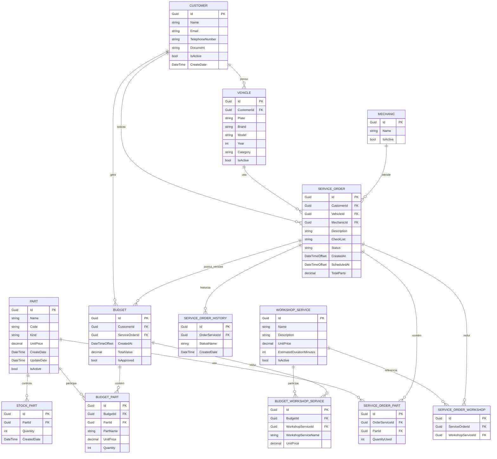

# Oficina API

[](https://github.com/thierryiago/SOAT-Fase-1-Lil-Golden-Hammer/actions/workflows/pipeline.yml)

API REST em .NET 10 para gestão operacional de uma oficina mecânica, cobrindo clientes, veículos, peças, estoque, mecânicos, serviços, ordens de serviço, orçamentos, histórico, métricas e notificações por e-mail.

## Sumário

- [Objetivo do projeto](#objetivo-do-projeto)
- [Arquitetura](#arquitetura)
- [Stack tecnológica](#stack-tecnológica)
- [Estrutura do repositório](#estrutura-do-repositório)
- [Requisitos mínimos](#requisitos-mínimos)
- [Como rodar a aplicação](#como-rodar-a-aplicação)
  - [Configuração inicial](#passo-2-configure-a-aplicação)
  - [Docker Compose](#passo-3-inicialize-os-serviços-com-docker)
  - [Validação da aplicação](#passo-4-verifique-se-a-api-subiu)
  - [Teste da API](#passo-5-teste-a-api)
- [Health checks, imagem Docker e HTTPS](#health-checks-imagem-docker-e-https)
- [Executando direto com .NET](#executando-direto-com-net)
- [Autenticação e autorização](#autenticação-e-autorização)
- [Endpoints principais](#endpoints-principais)
- [Fluxo de ordens de serviço](#fluxo-de-ordens-de-serviço)
- [Banco de dados](#banco-de-dados)
- [Migrations](#migrations)
- [Testes](#testes)
- [Mailpit para desenvolvimento](#mailpit-para-desenvolvimento)
- [Arquivo de chamadas HTTP](#arquivo-de-chamadas-http)
- [Resumo](#resumo)

## 🧭 Objetivo do projeto

O sistema foi concebido para centralizar e automatizar os processos da oficina, com foco em:

- cadastro e consulta de clientes e veículos;
- controle de peças e estoque;
- cadastro de mecânicos e serviços;
- abertura, atualização e acompanhamento de ordens de serviço;
- rastreio de histórico de status;
- geração e consulta de orçamentos;
- métricas de execução por serviço;
- envio de notificações por e-mail.

A solução segue princípios de Clean Architecture, separando domínio, aplicação, infraestrutura e API.

---

## 🏗️ Arquitetura

A estrutura do projeto está organizada em camadas:

- `src/Oficina.Domain` — entidades, regras de negócio e enums;
- `src/Oficina.Application` — serviços de aplicação, DTOs e contratos de repositório;
- `src/Oficina.Infrastructure` — EF Core, repositórios, SMTP, DI e persistência;
- `src/Oficina.Api` — controllers, autenticação, Swagger e bootstrap da API;
- `tests/Oficina.Tests` — testes unitários e de aplicação;
- `tests/Oficina.Api.ContractTests` — testes de contrato e integração HTTP.

Dependências:

- `Api -> Application -> Domain`
- `Infrastructure -> Application + Domain`

A feature de orçamentos usa cinco Use Cases dedicados na Application: listagem,
consulta por ID, abertura a partir da OS e decisão por OS ou por ID do orçamento.
Controllers e Service Orders injetam diretamente essas operações, registradas como
`Scoped`. A abertura mantém snapshots e versões anteriores; rotas e contratos HTTP
permanecem iguais.

---

## 🧰 Stack tecnológica

- .NET 10
- ASP.NET Core
- C#
- Entity Framework Core
- PostgreSQL
- Npgsql
- JWT Bearer
- Swagger / OpenAPI
- Docker / Docker Compose
- SMTP para e-mail
- xUnit + WebApplicationFactory

---

## 📁 Estrutura do repositório

```text
.
├── src/
│   ├── Oficina.Api/
│   ├── Oficina.Application/
│   ├── Oficina.Domain/
│   └── Oficina.Infrastructure/
├── tests/
│   ├── Oficina.Tests/
│   └── Oficina.Api.ContractTests/
├── docs/
│   └── SYSTEM_CONTEXT.md
├── docker-compose.yml
├── Dockerfile
├── Oficina.sln
├── oficina.http
├── README.md
├── seed-data.sql
├── coverage.xml
├── RelatorioHTML/
└── TestResults/
```

---

## ⚙️ Requisitos mínimos

Antes de começar, verifique se você tem:

- .NET 10 SDK
- Docker e Docker Compose
- PostgreSQL (se for rodar sem Docker)
- VS Code, Rider ou Visual Studio
- Git

---

## 🚀 Como rodar a aplicação

### Passo 1: clone o projeto

```bash
git clone <url-do-repositorio>
cd 17SOAT-Fase1
```

### Passo 2: configure a aplicação

O `appsettings.json` contém apenas configurações sem segredo. A API lê as variáveis de ambiente do .NET; para desenvolvimento local, também carrega o `.env` da raiz sem sobrescrever variáveis já definidas no sistema.

Exemplo de `appsettings.json`:

```json
{
  "AllowedHosts": "*",
  "Jwt": {
    "Issuer": "Oficina.Api",
    "Audience": "Oficina.Administration",
    "ExpirationMinutes": 120
  },
  "Smtp": {
    "Host": "smtp.example.com",
    "Port": 587,
    "From": "noreply@example.com",
    "EnableSsl": true
  }
}
```

Crie o `.env` a partir do exemplo e ajuste os valores:

```bash
cp .env.example .env
```

O mesmo `.env` é usado pelo Docker Compose (interpolação do `docker-compose.yml`) e pelo `dotnet run` (a API carrega o `.env` da raiz). Ajuste `App__PublicBaseUrl` para a origem pública usada em cada execução: `http://localhost:8080` no Compose ou `https://localhost:5001` no perfil local do `dotnet run`. A URL deve conter apenas esquema HTTP(S), host e porta opcional; a API valida esse valor ao iniciar.

| Variável | Destino K8S-3 | Uso |
|---|---|---|
| `App__PublicBaseUrl` | ConfigMap | Origem pública dos links de decisão nos e-mails; obrigatória no startup |
| `ConnectionStrings__Database` | Secret | Connection string da API e do Job de migrations; no Compose é montada a partir de `POSTGRES_DB`, `POSTGRES_USER` e `POSTGRES_PASSWORD` |
| `Jwt__SigningKey` | Secret | Chave de assinatura do JWT, com pelo menos 32 bytes |
| `Smtp__Host`, `Smtp__Port`, `Smtp__From`, `Smtp__EnableSsl` | ConfigMap | Endereço, porta, remetente e TLS do SMTP; Mailpit no Compose |
| `Smtp__Username`, `Smtp__Password` | Secret | Credenciais opcionais do SMTP; omitir quando o servidor não exige autenticação |
| `Webhooks__BudgetDecisionToken` | Secret | Reservado para K8S-3; ainda não é consumido pelos endpoints de decisão |

No Compose, `POSTGRES_PASSWORD` também deve vir de um segredo local. Para `dotnet run`, defina `ConnectionStrings__Database` no ambiente ou no `.env`; o valor de `appsettings.json` não fornece fallback.

> Importante: nunca versionar segredos reais em Git. O `.env` é ignorado pelo `.gitignore`.

### Passo 3: inicialize os serviços com Docker

Na raiz do projeto:

```bash
docker compose up --build -d
```

Os serviços sobem nesta ordem:

1. `db` (PostgreSQL) e `mailpit`;
2. `migrate`, que aplica as migrations e encerra (ver [Migrations](#migrations));
3. `api`, que só inicia se o `migrate` terminar com sucesso;
4. `seed`, que carrega os dados de exemplo depois que a API fica saudável.

Sem o `.env`, o `docker compose up` falha informando a variável obrigatória que falta.

> Se você já tinha o volume do banco criado com a senha antiga (`oficina_dev_password`), o PostgreSQL mantém essa senha. Use-a em `POSTGRES_PASSWORD` ou recrie o volume com `docker compose down -v` (apaga os dados locais).

### Passo 4: verifique se a API subiu

Depois do startup, valide:

- API: `http://localhost:8080`
- Swagger: `http://localhost:8080/swagger`
- Health checks: `http://localhost:8080/health/live` (liveness) e `http://localhost:8080/health/ready` (readiness, verifica o Postgres)
- Mailpit: `http://localhost:8025`

### Passo 5: teste a API

Acesse o Swagger em:

```text
http://localhost:8080/swagger
```

No Swagger, use o endpoint de geração de token:

```http
POST /api/v1/auth/token
```

Copie o token e o envie em todas as requisições protegidas:

```http
Authorization: Bearer <accessToken>
```

---

## 🩺 Health checks, imagem Docker e HTTPS

### Endpoints de saúde

| Rota | Verifica | Uso | Resposta |
|---|---|---|---|
| `/health/live` | nada (só que o processo responde) | `livenessProbe` | `200` |
| `/health/ready` | conexão com o Postgres | `readinessProbe` e healthcheck do compose | `200` ou `503` com o banco indisponível |
| `/health` | nada (igual ao `/health/live`) | compatibilidade | `200` |

Todos são anônimos e sem cache. Exemplo para o Kubernetes: `livenessProbe.httpGet.path: /health/live` e `readinessProbe.httpGet.path: /health/ready`, porta `8080`.

### Imagem Docker

- **Tags fixadas:** o `Dockerfile` usa `SDK_VERSION` e `RUNTIME_VERSION` (tags de patch). Para atualizar, ajuste os dois `ARG` e valide o build.
- **Labels OCI:** `org.opencontainers.image.version` e `.revision` vêm dos `ARG VERSION` e `VCS_REF`:
  ```bash
  docker build --build-arg VERSION=1.0.0 --build-arg VCS_REF=$(git rev-parse HEAD) -t oficina-api .
  ```
  Sem os argumentos, ficam `dev` e `unknown`.
- **Sem `curl`:** a imagem final não instala `curl`. O healthcheck do compose faz a requisição com `bash` (`/dev/tcp`). No Kubernetes o probe é `httpGet` do kubelet e não precisa de nada na imagem.
- **Redirecionamento HTTPS:** controlado por `HttpsRedirection__Enabled` (padrão `true` no `dotnet run`). A imagem define `false`, porque o TLS termina no proxy/ingress.

## 🧪 Executando direto com .NET

Se preferir rodar sem Docker:

```bash
dotnet restore
dotnet build
dotnet run --project src/Oficina.Api/Oficina.Api.csproj
```

Antes disso, confirme que o PostgreSQL está acessível e que os dados de conexão estão corretos.

A API **não** aplica migrations ao iniciar. Antes de rodá-la, atualize o banco de uma das formas:

```bash
# banco e migrations pelo Docker Compose
docker compose up -d db migrate

# ou, com um PostgreSQL próprio
dotnet ef database update \
  --project src/Oficina.Infrastructure \
  --startup-project src/Oficina.Api
```

---

## 🔐 Autenticação e autorização

A API usa autenticação JWT Bearer com token técnico único.

### Endpoints públicos

- `POST /api/v1/auth/token`
- `GET /health` (compatibilidade; equivale a `/health/live`)
- `GET /health/live`
- `GET /health/ready`

### Endpoints protegidos

A maior parte da API exige JWT, incluindo:

- clientes;
- veículos;
- peças;
- estoque;
- mecânicos;
- serviços;
- ordens de serviço;
- métricas;
- histórico.

> Observação: `BudgetsController` exige `[Authorize]` desde a ARCH-25. `NotificationsController` continua sem `[Authorize]` por decisão: é usado no fluxo do cliente, que não tem credencial administrativa.

---

## 🧾 Endpoints principais

### Auth

- `POST /api/v1/auth/token`

### Clientes

- `GET /api/v1/customers`
- `GET /api/v1/customers/{id}`
- `POST /api/v1/customers`
- `PUT /api/v1/customers/{id}`
- `DELETE /api/v1/customers/{id}`

### Veículos

- `GET /api/v1/vehicles`
- `GET /api/v1/vehicles/{id}`
- `POST /api/v1/vehicles`
- `POST /api/v1/vehicles/identify-customer-and-register`
- `PUT /api/v1/vehicles/{id}`
- `DELETE /api/v1/vehicles/{id}`

### Peças

- `GET /api/v1/parts`
- `GET /api/v1/parts/{id}`
- `POST /api/v1/parts`
- `PUT /api/v1/parts/{id}`
- `DELETE /api/v1/parts/{id}`

### Estoque

- `GET /api/v1/stocks`
- `GET /api/v1/stocks/{id}`
- `PUT /api/v1/stocks/stocks-part/{partId}/entries`
- `PUT /api/v1/stocks/stocks-part/{partId}/consumptions`
- `PUT /api/v1/stocks/stocks-part/{partId}/adjustments`

### Mecânicos

- `GET /api/v1/mechanics`
- `GET /api/v1/mechanics/{id}`
- `POST /api/v1/mechanics`
- `PUT /api/v1/mechanics/{id}`
- `DELETE /api/v1/mechanics/{id}`

### Serviços da oficina

- `GET /api/v1/workshop-services`
- `GET /api/v1/workshop-services/{id}`
- `POST /api/v1/workshop-services`
- `PUT /api/v1/workshop-services/{id}`
- `DELETE /api/v1/workshop-services/{id}`

### Ordens de serviço

As respostas dos endpoints de ordens de serviço apresentam `status` pelo nome do enum (por exemplo, `"AwaitingApproval"`), ou `null` quando não houver status.

- `GET /api/v1/service-orders`
- `GET /api/v1/service-orders/status` — lista autenticada por prioridade: `InExecution` > `AwaitingApproval` > `InDiagnosis` > `Received`. Dentro de cada status, retorna as OS mais antigas por `CreatedAt`, com desempate por `Id`. Exclui `Created`, `Rejected`, `Finalized`, `Delivered` e status nulo apenas desta consulta, preservando registros e históricos. Retorna `200` com uma lista (vazia quando não houver OS elegíveis) ou `401` sem autenticação. A listagem geral continua disponível sem esse filtro.
- `GET /api/v1/service-orders/{id}`
- `POST /api/v1/service-orders`
- `PUT /api/v1/service-orders`
- `POST /api/v1/service-orders/{id}/approve`
- `POST /api/v1/service-orders/{id}/cancel`
- `POST /api/v1/service-orders/{id}/finalize`
- `POST /api/v1/service-orders/{id}/deliver`

### Histórico

- `GET /api/v1/service-order-history`
- `GET /api/v1/service-order-history/service-order/{serviceOrderId}`

### Orçamentos

- `GET /api/v1/budgets`
- `GET /api/v1/budgets/{id}`

### Métricas

- `GET /api/v1/metrics/workshop-service/execution-time`

### Notificações

- `POST /api/v1/notifications/email`

---

## 🔄 Fluxo de ordens de serviço

O ciclo de vida da OS é governado pelo domínio e por regras de negócio da aplicação. Uma ordem recém-aberta possui o status `Created` até o checklist ser informado.

Estados principais:

- `Created`
- `Received`
- `InDiagnosis`
- `AwaitingApproval`
- `InExecution`
- `Finalized`
- `Delivered`
- `Rejected`

Fluxo geral:

```text
Created -> Received -> InDiagnosis -> AwaitingApproval -> InExecution -> Finalized -> Delivered
InDiagnosis -> AwaitingApproval -> Rejected
InExecution -- alteração de peças/serviços --> AwaitingApproval
```

### Como o status evolui

- `Created`: ordem aberta; ainda sem checklist validado;
- `Received`: checklist preenchido e OS recebida;
- `InDiagnosis`: mecânico atribuído e diagnóstico em andamento;
- `AwaitingApproval`: serviços adicionados e a aprovação do cliente é aguardada;
- `InExecution`: cliente aprovou e a execução começou;
- `Finalized`: execução concluída;
- `Delivered`: entrega finalizada;
- `Rejected`: aprovação negada, encerrando o processo.

Se peças ou serviços forem alterados durante `InExecution`, a OS retorna para
`AwaitingApproval`. O sistema ajusta o estoque pelos deltas, preserva o orçamento
aprovado, cria uma nova versão pendente e envia outro e-mail ao cliente. Reenviar a
mesma composição não solicita reaprovação, e ao menos um serviço de oficina deve
permanecer na OS.

Cada entrada em `AwaitingApproval` cria um novo orçamento. Os endpoints `approve` e
`cancel` registram a decisão no orçamento mais recente, enquanto as versões
anteriores permanecem inalteradas. Sempre que houver mudança de status, o sistema
registra um histórico em `ServiceOrderHistory` para auditoria.

---

## 🗃️ Banco de dados

O projeto usa PostgreSQL com EF Core e Fluent API para mapear as entidades.

### Diagrama Mermaid do banco



---

## 🛠️ Migrations

Para criar uma migration:

```bash
dotnet ef migrations add NomeDaMigracao \
  --project src/Oficina.Infrastructure \
  --startup-project src/Oficina.Api
```

Para aplicar:

```bash
dotnet ef database update \
  --project src/Oficina.Infrastructure \
  --startup-project src/Oficina.Api
```

> Importante: não edite `AppDbContextModelSnapshot.cs` manualmente; sempre gere a migration correta.

### Imagem de migração (bundle)

A API não migra o banco ao iniciar, para que várias réplicas não tentem migrar ao mesmo tempo. As migrations são aplicadas por uma imagem própria, gerada pelo target `migrations` do `Dockerfile` com `dotnet ef migrations bundle`.

| Item | Valor |
|---|---|
| Build | `docker build --target migrations -t oficina-migrations:dev .` |
| Variável obrigatória | `ConnectionStrings__Database` |
| Comportamento | Aplica só as migrations pendentes e encerra; pode ser executada de novo sem efeito |
| Exit code | `0` em sucesso; diferente de `0` em falha ou sem a variável |
| Usuário | Não-root |

O `dotnet ef migrations bundle` não acessa o banco: ele só gera o executável `efbundle` durante o build. As migrations são aplicadas quando o container roda:

```bash
docker run --rm \
  -e ConnectionStrings__Database="Host=<host>;Port=5432;Database=oficina;Username=<usuario>;Password=<senha>" \
  oficina-migrations:dev
```

No Docker Compose, essa imagem é o serviço `migrate`. No Kubernetes, ela será executada por um Job antes da atualização da API ([#120](https://github.com/thierryiago/SOAT-Fase-1-Lil-Golden-Hammer/issues/120)).

---

## 🧪 Testes

### Testes unitários

```bash
dotnet test tests/Oficina.Tests/Oficina.Tests.csproj
```

### Testes de contrato

```bash
dotnet test tests/Oficina.Api.ContractTests/Oficina.Api.ContractTests.csproj
```

### Integração e entrega contínuas

Todo push na `main` dispara a esteira [`.github/workflows/pipeline.yml`](.github/workflows/pipeline.yml), que também pode ser disparada pelo **Run workflow**. Ela tem três etapas, e cada uma só começa se a anterior passou:

1. **CI** ([`ci.yml`](.github/workflows/ci.yml)): `restore` → `build` (Release) → testes de arquitetura → testes unitários (com coverage) → testes de contrato. Os resultados (`.trx` e coverage) ficam no artifact `test-results`.
2. **Publish** ([`publish-images.yml`](.github/workflows/publish-images.yml)): publica no Docker Hub as imagens `api-<sha7>` e `migrations-<sha7>` do commit, e também `*-latest`.
3. **CD** ([`cd-localstack.yml`](.github/workflows/cd-localstack.yml)): sobe o LocalStack no runner e aplica o Terraform (EKS e RDS). Depois faz o deploy de `/k8s` com as imagens desse commit, roda o smoke test e o teste de ponta a ponta. O resumo do teste aparece na página da execução e o relatório HTML fica no artifact `relatorio-e2e`.

As etapas continuam em arquivos separados, chamados pela esteira via `workflow_call`. Cada uma ainda pode ser disparada sozinha pelo **Run workflow**. O `ci.yml` também roda em todo pull request para a `main`.

A versão do SDK é fixada em [`global.json`](global.json).

---

## 📬 Mailpit para desenvolvimento

O projeto usa Mailpit como servidor SMTP local para evitar envio real de e-mails durante o desenvolvimento.

### Acesso

- UI do Mailpit: `http://localhost:8025`

### Exemplo de envio de notificação

```http
POST /api/v1/notifications/email
Content-Type: application/json

{
  "email": "cliente@example.com"
}
```

Depois disso, abra o Mailpit e confirme a mensagem capturada.

### Notificações automáticas da ordem de serviço

A abertura da OS e cada mudança efetiva de status enviam um e-mail em português ao cliente, com identificação da OS, veículo, acontecimento e status atual. Atualizações sem mudança de status não enviam mensagem.

Em **Aguardando aprovação**, o próprio e-mail de orçamento contém a atualização e os links de decisão. Em **Finalizada**, a mensagem de veículo pronto informa a conclusão. Não há e-mail adicional nesses eventos. Alterações de composição durante a execução geram uma nova versão de orçamento e uma nova mensagem solicitando aprovação.

Falhas na preparação ou no SMTP são registradas em log, sem desfazer a operação nem retornar erro HTTP por causa do e-mail. O envio ocorre após a persistência e não possui fila ou tentativas automáticas.

Para verificar localmente, use `docker compose up --build -d` e execute o fluxo de OS em `oficina.http` com um cliente fictício. No Mailpit (`http://localhost:8025`), filtre pelo destinatário: o caminho Criada → Recebida → Em diagnóstico → Aguardando aprovação → Em execução → Finalizada → Entregue deve produzir **sete mensagens**. O caminho que termina em Rejeitada produz **cinco**. Cada retorno para aprovação e nova aprovação acrescenta duas mensagens. Confira os textos, a identificação da OS e a presença de apenas um orçamento por entrada em Aguardando aprovação.

Os links de decisão usam `App__PublicBaseUrl`. Para o Docker Compose local, mantenha `http://localhost:8080` no `.env`; para outra origem pública, ajuste a variável antes de iniciar a API.

---

## 📄 Arquivo de chamadas HTTP

O arquivo [`oficina.http`](oficina.http) serve como guia de testes e automação básica da API.

Ele inclui cenários de:

- autenticação;
- cadastro de clientes;
- veículos;
- peças e estoque;
- serviços;
- ordem de serviço;
- histórico e status.

Recomendação de uso:

1. suba a API;
2. confirme `GET /health`;
3. execute o fluxo principal do `oficina.http`;
4. respeite a ordem das chamadas para reaproveitar IDs gerados.

---

## 📌 Resumo

A Oficina API é uma solução de back-end para gestão de oficina mecânica, com foco em domínio, rastreabilidade e fluxo operacional de ordem de serviço. O projeto já inclui autenticação JWT, controle de estoque, orçamentos, métricas e notificações, além de uma suíte de testes para garantir a qualidade do comportamento da aplicação.
